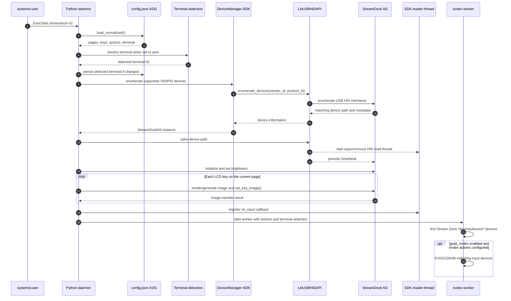
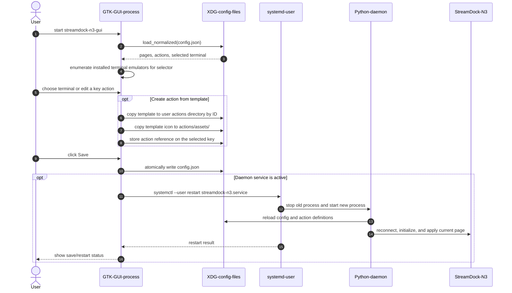

# Architecture and Communication Flows

The application has two Python processes with different responsibilities:

- `streamdock-n3.service` runs the daemon. It owns the USB HID connection, receives device events, updates key images, and dispatches configured actions.
- `streamdock-n3-gui` is a separate GTK application. It edits the user's configuration and asks systemd to restart the daemon after saving when the service is active.

The daemon communicates with the Stream Dock over two input paths. Button and knob reports arrive through the vendored SDK over USB HID/libusb. Some firmware modes also expose media-key events through Linux evdev; that path is read independently and can be grabbed when matching actions are configured. Display updates travel back to the device over USB HID.

## Service Startup and Device Connection



`DeviceManager` creates a device-specific `LibUSBHIDAPI` transport for each enumerated device. Opening the SDK device starts its reader and heartbeat threads. The daemon then initializes the N3, renders the current page, registers its callback, and starts the independent evdev worker.

## Device Input and Action Dispatch

```mermaid
sequenceDiagram
    autonumber
    participant Dock as StreamDock-N3
    participant HID as USB-HID-transport
    participant Reader as SDK-reader-thread
    participant Daemon as Python-daemon
    participant Evdev as evdev-worker
    participant Config as XDG-config-and-actions
    participant Terminal as Selected-terminal
    participant Shell as Command-shell
    participant App as Application-or-xdg-open

    alt Button/knob event over USB HID
        Dock->>HID: HID input report
        HID->>Reader: read_() returns report bytes
        Reader->>Reader: decode_input_event()
        Reader->>Daemon: on_input(device, InputEvent)
        Daemon->>Daemon: event_key() maps event to config key
    else Media-key event over Linux evdev
        Dock->>Evdev: kernel input event on /dev/input/event*
        Evdev->>Evdev: select(), read(), map event_key
        Evdev->>Daemon: dispatch mapped action
    end

    alt Page-navigation action
        Daemon->>Daemon: update current page and action map
        Daemon->>HID: render and send the new page's key images
        HID->>Dock: key image reports and refresh
    else Configured action
        Daemon->>Config: resolve reference ID, if action is a template copy
        Config-->>Daemon: action definition from the user actions directory
        Daemon->>Daemon: validate and dispatch action type
        alt Shell action with output enabled
            Daemon->>Terminal: launch selected emulator with cwd and command
            Terminal->>Shell: execute command
            Shell-->>Terminal: stdout, stderr, and exit status
            Note over Terminal: Output remains visible until the user closes the terminal
        else Shell action without output
            Daemon->>Shell: spawn command in background; stdout/stderr discarded
        else Application launch or URL
            Daemon->>App: Popen(argv, shell=False)
        else Sequence action
            Daemon->>Daemon: run first step, schedule later steps with Timer
        end
    end
```

HID events are decoded by the SDK reader thread before the daemon callback runs. evdev events do not pass through that decoder; the worker maps Linux key codes separately and uses the same action dispatcher. For a shell action with `show_output`, the selected emulator runs the command in a shell, so the command's standard output and error are attached to that terminal rather than a GTK dialog.

## GUI Configuration and Service Restart



The GUI does not open or control the USB device directly. It writes the user's config and action files; the daemon is the only process that owns the device connection. Action templates are copied into the user's XDG config directory so personal edits do not modify the packaged templates.

## Related Code

- [Daemon lifecycle and action dispatch](../src/streamdock_n3/daemon.py)
- [Terminal discovery and command launching](../src/streamdock_n3/terminals.py)
- [Configuration loading, migration, and action references](../src/streamdock_n3/config.py)
- [GUI and systemd integration](../src/streamdock_n3/gui.py)
- [Vendored device discovery](../src/streamdock_n3/_vendor/StreamDock/DeviceManager.py)
- [Stream Dock service unit](../src/streamdock_n3/_data/streamdock-n3.service)