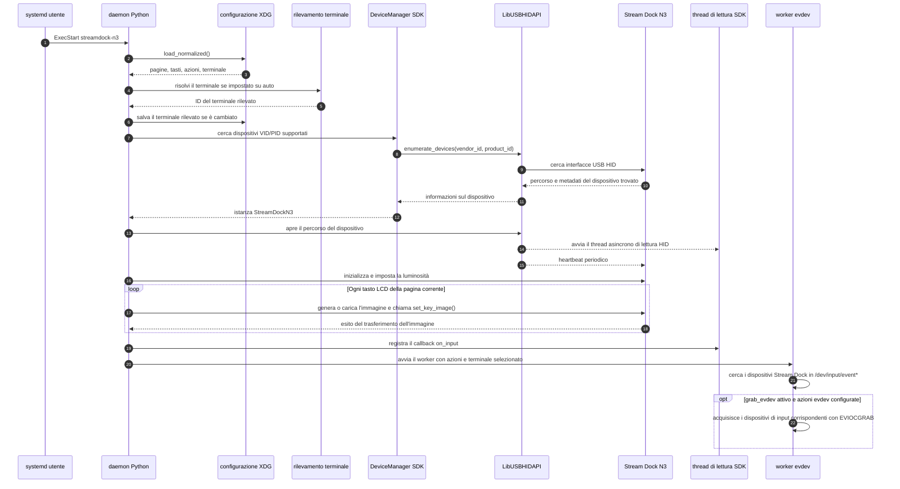
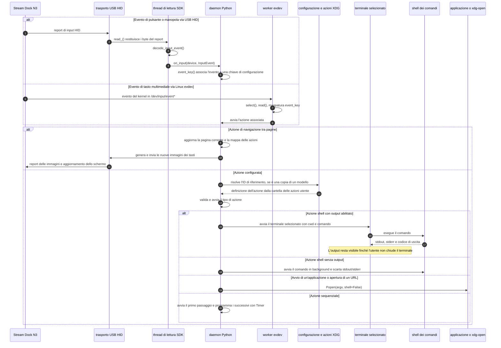
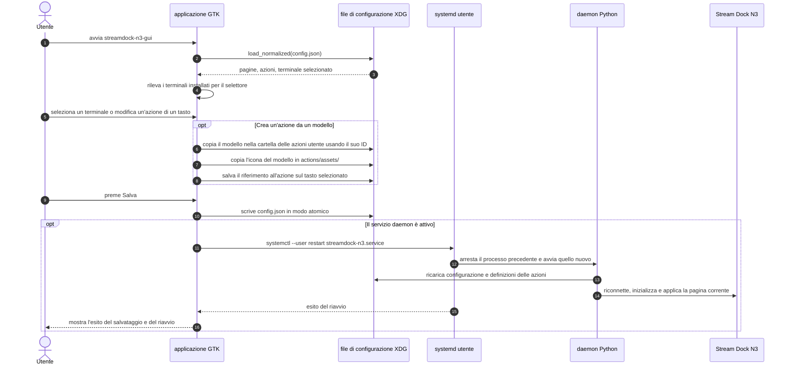

# Architettura e flussi di comunicazione

L'applicazione è composta da due processi Python con responsabilità distinte:

- `streamdock-n3.service` esegue il daemon. Gestisce la connessione USB HID, riceve gli eventi del dispositivo, aggiorna le immagini dei tasti e avvia le azioni configurate.
- `streamdock-n3-gui` è un'applicazione GTK separata. Modifica la configurazione dell'utente e, dopo il salvataggio, chiede a systemd di riavviare il daemon se il servizio è attivo.

Il daemon comunica con Stream Dock tramite due percorsi di input. Gli eventi di pulsanti e manopole arrivano attraverso l'SDK incluso nel progetto, usando USB HID/libusb. Alcune modalità del firmware espongono anche eventi dei tasti multimediali tramite Linux evdev; questo percorso viene letto separatamente e può essere acquisito quando sono configurate azioni corrispondenti. Gli aggiornamenti dello schermo tornano al dispositivo attraverso USB HID.

## Avvio del servizio e connessione al dispositivo

`DeviceManager` crea un trasporto `LibUSBHIDAPI` specifico per ogni dispositivo trovato. L'apertura del dispositivo SDK avvia i thread di lettura e heartbeat. Il daemon inizializza quindi l'N3, disegna la pagina corrente, registra il callback e avvia il worker evdev indipendente.

## Input del dispositivo e avvio delle azioni

Gli eventi HID vengono decodificati dal thread di lettura SDK prima di raggiungere il callback del daemon. Gli eventi evdev non passano da quel decoder: il worker mappa separatamente i codici dei tasti Linux e usa lo stesso dispatcher delle azioni. Per un'azione shell con `show_output`, il terminale selezionato esegue il comando in una shell; stdout e stderr vengono quindi mostrati nel terminale e non in una finestra GTK.

## Configurazione GUI e riavvio del servizio

La GUI non apre né controlla direttamente il dispositivo USB. Scrive i file di configurazione e delle azioni dell'utente; il daemon è l'unico processo che gestisce la connessione al dispositivo. I modelli di azione vengono copiati nella cartella XDG dell'utente, così le modifiche personali non alterano i modelli inclusi nel pacchetto.

## Codice correlato

- [Ciclo di vita del daemon e avvio delle azioni](../src/streamdock_n3/daemon.py)
- [Rilevamento dei terminali e avvio dei comandi](../src/streamdock_n3/terminals.py)
- [Caricamento della configurazione, migrazione e riferimenti alle azioni](../src/streamdock_n3/config.py)
- [GUI e integrazione con systemd](../src/streamdock_n3/gui.py)
- [Rilevamento dei dispositivi incluso nel progetto](../src/streamdock_n3/_vendor/StreamDock/DeviceManager.py)
- [Unità di servizio Stream Dock](../src/streamdock_n3/_data/streamdock-n3.service)